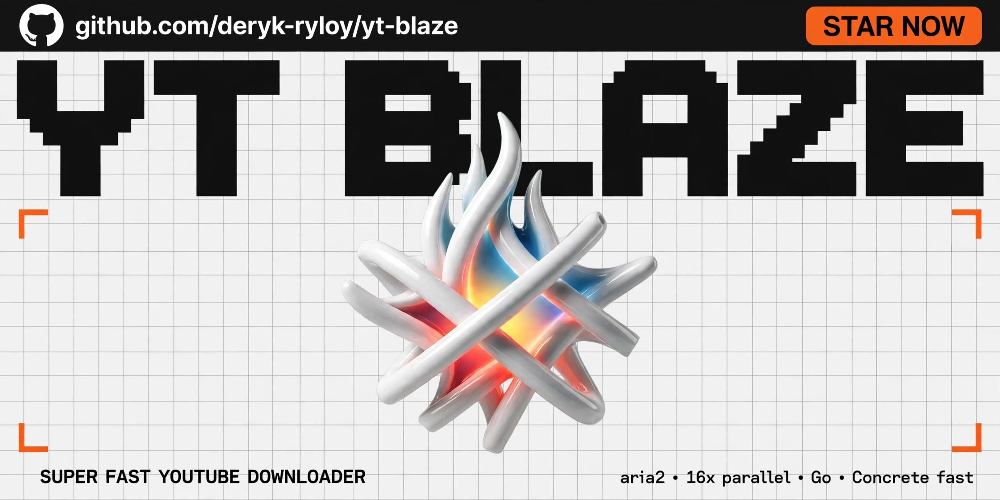
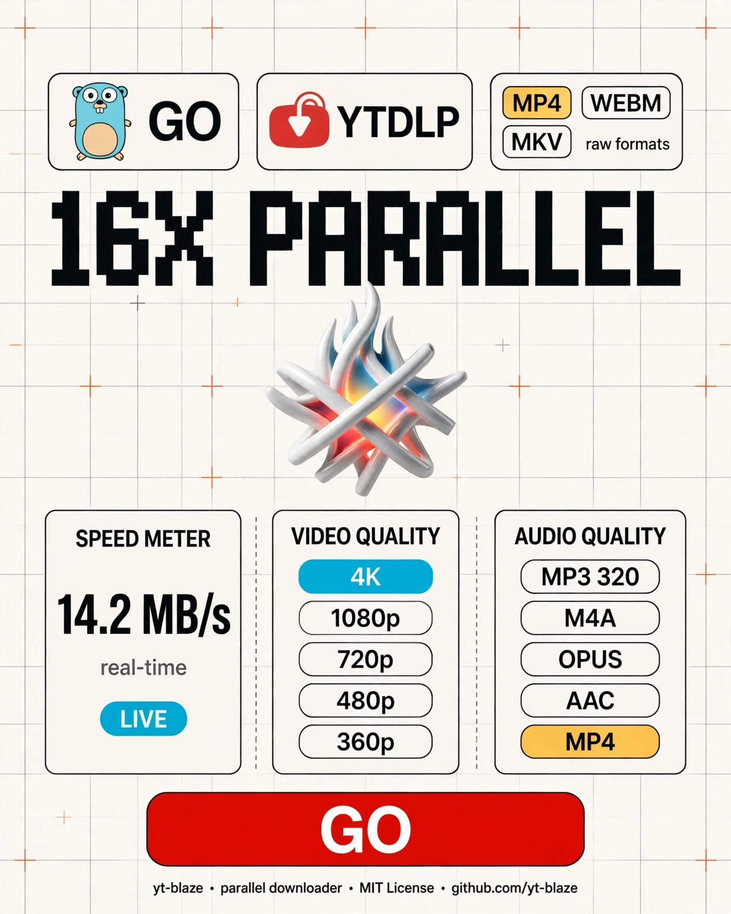
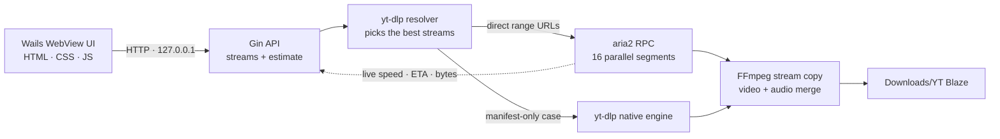
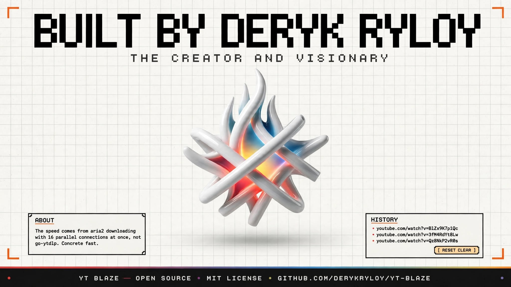

<div align="center">


# YT BLAZE

**The fastest YouTube downloader for Windows.**

aria2's 16-connection engine · yt-dlp resolution · a native Go desktop app that never breaks a sweat.

[](https://github.com/DERYK-RYLOY/yt-blaze/releases/latest)
[](https://github.com/DERYK-RYLOY/yt-blaze/stargazers)

<br/>


[](https://github.com/DERYK-RYLOY/yt-blaze/stargazers)

</div>

<br/>

<div align="center">
  
</div>

<br/>

<div align="center">

### `16 CONNECTIONS. ONE FILE. ZERO WAITING.`

Most downloaders open a single connection and hope for the best. Blaze splits every file into segments and pulls them **16 at a time** through aria2's engine — the same trick professional download managers use, wrapped in a native desktop app that actually looks like something from this decade.

</div>

---

## ▸ Why Blaze is the fastest downloader on Windows

Speed isn't a marketing word here — it's an architectural decision.

| | Typical downloader | **YT Blaze** |
| :--- | :--- | :--- |
| Connections per file | 1 | **up to 16 parallel segments** |
| Engine | generic HTTP client | **aria2 JSON-RPC engine** |
| Stream selection | guesses a format | **yt-dlp resolves every available stream** |
| Progress | estimated / fake | **real bytes reported by the engine** |
| Interrupted download | starts over | **resumes segment by segment** |
| Merging video + audio | re-encodes | **FFmpeg stream copy — no quality loss** |
| Console windows | flash on screen | **completely hidden** |

A single TCP connection is capped by latency and per-stream throttling. Sixteen segmented range requests fill the pipe from several directions at once, so Blaze keeps eating bandwidth while a single-stream downloader is still waiting on its first chunk.

And because the final step is a **stream copy** (`ffmpeg -c copy`), the file you get is the exact video and audio YouTube served — no re-encode, no quality loss, no CPU meltdown. Big file in, big file out, at the speed of your line.

<br/>

<div align="center">
  
</div>

<br/>

## ▸ Features

<table>
<tr>
<td width="50%" valign="top">

**⚡ 16-way parallel engine**
Files are segmented and fetched concurrently through aria2 — not a single slow stream.

**🎯 Real-time truth**
Live speed, ETA, byte count and filename streamed from the engine over SSE. The progress bar moves because the file moves.

**🎚 Full quality ladder**
4K · 1080p · 720p · 480p · 360p, or audio only in MP3 320 / M4A / OPUS / AAC.

</td>
<td width="50%" valign="top">

**📦 Every container**
MP4, WEBM, MKV — or `raw` when you want the untouched source streams.

**🧠 Smart estimates**
Pick a quality and Blaze tells you the size before you commit — including converted audio sizes.

**🪶 Native and quiet**
Wails + WebView2, dark native title bar, no console boxes, no Electron bloat, no updater nag.

</td>
</tr>
<tr>
<td width="50%" valign="top">

**🧾 History, one click**
Recent links are stored locally; click to re-run a download.

**🛡 Safe by design**
The API binds to `127.0.0.1` only, on a random free port, with a per-launch aria2 secret.

**📂 Files where you expect**
Everything lands in `Downloads\YT Blaze`.

</td>
<td width="50%" valign="top">

**🔁 Self-healing tools**
First launch provisions yt-dlp, FFmpeg and aria2 into your profile — updates when they need to.

**🎨 Designed, not themed**
A dark gradient stage, glass panels, pixel display type and a scan-of-light animation that sweeps the logo only while a download is running.

**📜 MIT licensed**
Source included. Fork it, learn from it, ship your own.

</td>
</tr>
</table>

---

## ▸ Install

### The quick way

1. Grab **`ytblaze-desktop-amd64-installer.exe`** from [**Releases**](https://github.com/DERYK-RYLOY/yt-blaze/releases/latest).
2. Run it. Windows SmartScreen may warn because the build is unsigned — choose **More info → Run anyway**.
3. Launch **YT Blaze** from the Start Menu or desktop shortcut.
4. Paste a YouTube link, pick a format and quality, hit **GO**.

On first launch Blaze provisions its engines (yt-dlp, FFmpeg, aria2) into your user profile and the WebView2 runtime if it's missing. Nothing else to install.

### The source way

```bash
git clone https://github.com/DERYK-RYLOY/yt-blaze.git
cd yt-blaze

# requirements
#   Go 1.27+
#   Wails v2        ->  go install github.com/wailsapp/wails/v2/cmd/wails@latest
#   NSIS (installer) ->  https://nsis.sourceforge.io

wails build -platform windows/amd64 -nsis
```

Artifacts:

```
build/bin/YT Blaze.exe                        # the app
build/bin/ytblaze-desktop-amd64-installer.exe # the installer
```

---

## ▸ Built with

<div align="center">


</div>

---

## ▸ How it works



1. **Resolve** — yt-dlp extracts every available format for the URL.
2. **Choose** — Blaze picks the highest video under your cap and the best audio for your container.
3. **Blast** — direct HTTP streams are handed to aria2 with 16 segmented connections; manifest-only formats fall back to yt-dlp's native downloader.
4. **Merge** — FFmpeg copies the streams into your chosen container without re-encoding.
5. **Report** — the engine's live numbers flow through SSE into the UI, so the meter and the progress bar are the truth.

<div align="center">
  
</div>

<br/>

## ▸ Local API

The desktop UI and the headless server share one backend. Useful if you want to script it.

| Method | Route | Purpose |
| :--- | :--- | :--- |
| `GET` | `/api/health` | status, version, which engines are live |
| `POST` | `/api/estimate` | resolve a URL and size every quality/audio variant |
| `POST` | `/api/download` | start a download `{ url, container, quality, audio_only, audio }` |
| `DELETE` | `/api/downloads/:id` | cancel |
| `GET` | `/api/progress` | one-shot progress snapshot |
| `GET` | `/api/progress/stream` | SSE live progress |
| `GET` / `DELETE` | `/api/history` | list / clear recent links |

```bash
curl -s -X POST http://127.0.0.1:8080/api/estimate \
  -H "Content-Type: application/json" \
  -d '{"url":"https://www.youtube.com/watch?v=jNQXAC9IVRw"}'
```

---

## ▸ FAQ

<details>
<summary><b>Where do my downloads go?</b></summary>

`%USERPROFILE%\Downloads\YT Blaze`. Open it from the folder icon in the app.
</details>

<details>
<summary><b>Why does SmartScreen warn me?</b></summary>

The installer isn't code-signed yet, so Windows shows the standard "unknown publisher" prompt. The source is here — build it yourself if you prefer.
</details>

<details>
<summary><b>Why not just use a browser extension?</b></summary>

Browsers download one stream, one connection, and often can't mux separate video/audio tracks at all. Blaze resolves the real streams, downloads them 16-way in parallel, and merges them losslessly.
</details>

<details>
<summary><b>Is the size estimate exact?</b></summary>

It's exact when YouTube publishes a byte size for the stream, and a bitrate × duration estimate otherwise. Audio sizes match the converted file you'll actually get.
</details>

<details>
<summary><b>Downloading fails on a specific video?</b></summary>

YouTube changes things regularly. yt-dlp updates itself on launch; if it still fails, open an issue with the URL.
</details>

<details>
<summary><b>Can I use it without the desktop app?</b></summary>

Yes. `go run ./fastdl/cmd/server` serves the same API (and the server UI) on `127.0.0.1:8080`.
</details>

---

## ▸ Project layout

```
yt-blaze/
├─ main.go                     # Wails shell, window options, bindings
├─ frontend/                   # the UI (HTML, CSS, JS — no framework)
│  ├─ index.html
│  ├─ styles.css
│  ├─ app.js
│  └─ assets/                  # logo + fonts
├─ fastdl/                     # the download engine (importable Go module)
│  ├─ backend.go               # Gin API, SSE progress hub
│  ├─ resolve.go               # yt-dlp format selection
│  ├─ estimate.go              # size estimates per quality
│  ├─ download.go              # aria2 + native download pipeline
│  ├─ aria2.go                 # RPC daemon lifecycle
│  ├─ setup.go                 # tool provisioning
│  └─ cmd/server/              # headless server
├─ build/                      # icons, manifest, NSIS installer theme
└─ assets/brand/               # the artwork in this README
```

---

## ▸ Roadmap

- [x] 16-connection aria2 engine
- [x] Live engine-accurate progress
- [x] Audio-only mode with estimates
- [x] Dark native UI + flame icon
- [x] Themed NSIS installer
- [ ] Code signing certificate
- [ ] Playlist downloads
- [ ] Winget manifest

---

<div align="center">

**If Blaze saved you time, a ⭐ on this repo keeps the fire going.**

<br/>


<sub>MIT Licensed · Copyright 2026 <b>DERYK RYLOY</b> · <a href="THIRD-PARTY-NOTICES.md">third-party notices</a></sub>
<br/>
<sub>Not affiliated with, endorsed by, or sponsored by YouTube or Google LLC.</sub>
<br/><br/>

`#golang` `#wails` `#aria2` `#ytdlp` `#ffmpeg` `#webview2` `#windows` `#desktopapp` `#youtubedownloader` `#opensource` `#mit` `#concretefast`

</div>
